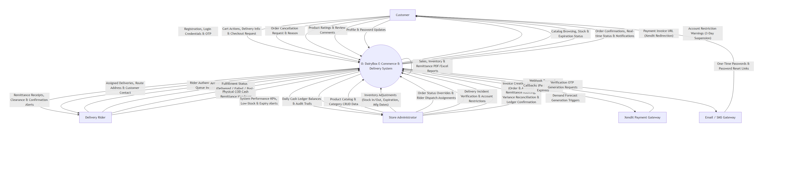
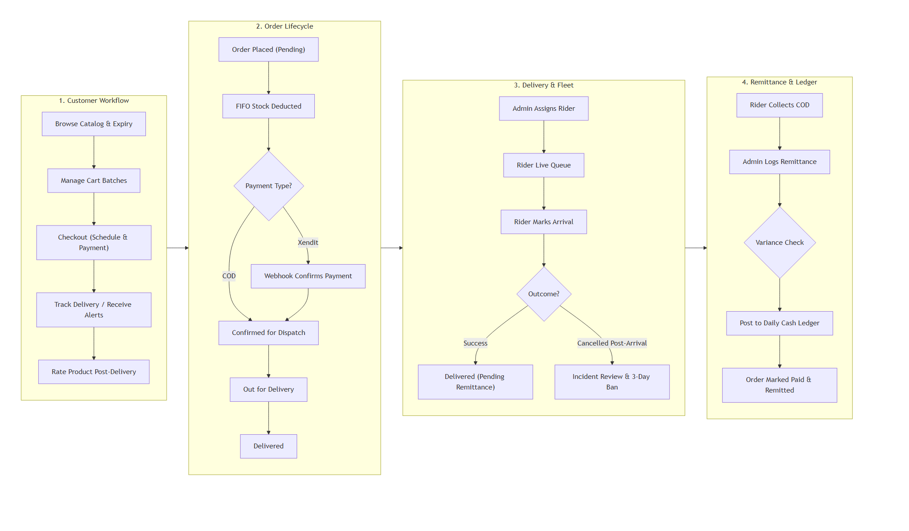
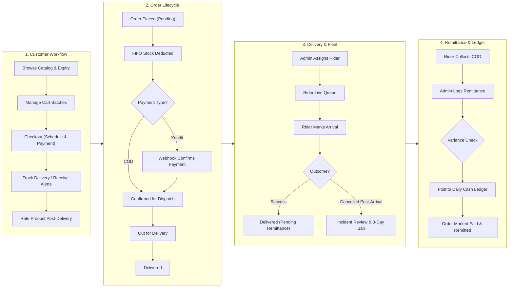

# DairyBox System Architecture — Data Flow Diagrams (DFD)

This document provides a comprehensive architectural data flow analysis of the **DairyBox** web-based ordering, inventory, delivery, and sales management platform. The diagrams and explanations adhere to **Yourdon-DeMarco DFD conventions** and represent the actual codebase implementation across Laravel routes, controllers, models, and database migrations.

---

## 1. DFD Conventions & Notation

The diagrams follow standard Yourdon-DeMarco notation rendered via Mermaid:

| DFD Element | Yourdon-DeMarco Symbol | Mermaid Shape Syntax | Description |
| :--- | :--- | :--- | :--- |
| **External Entity** | Rectangle | `EntityID["Entity Name"]` | People, roles, or external systems outside the boundary that produce or consume data. |
| **Process** | Circle / Bubble | `ProcessID(("ID: Process Name"))` | Transforms incoming data into outgoing data. |
| **Data Store** | Cylindrical / Parallel Lines | `StoreID[("ID: Store Name")]` | Data at rest (database tables or persistence layers). |
| **Data Flow** | Directed Arrow | `-->|"Data Payload"|` | Directed movement of data between entities, processes, and stores. |

---

## 2. Level 0: Context Diagram

The Level 0 Context Diagram depicts the entire **DairyBox System** as a single high-level process (`0: DairyBox E-Commerce & Delivery System`) and illustrates the data boundaries with its external actors and third-party integrations.

*High-Resolution Exports: [PNG Image (3972x866)](file:///c:/dairybox/docs/level_0_context_diagram.png) | [Scalable Vector SVG](file:///c:/dairybox/docs/level_0_context_diagram.svg)*

```mermaid
flowchart TD
    %% External Entities
    Customer["Customer"]
    Rider["Delivery Rider"]
    Admin["Store Administrator"]
    Xendit["Xendit Payment Gateway"]
    OtpService["Email / SMS Gateway"]

    %% Central Process
    System(("0: DairyBox E-Commerce & Delivery System"))

    %% Customer Data Flows
    Customer -->|"Registration, Login Credentials & OTP"| System
    Customer -->|"Cart Actions, Delivery Info & Checkout Request"| System
    Customer -->|"Order Cancellation Request & Reason"| System
    Customer -->|"Product Ratings & Review Comments"| System
    Customer -->|"Profile & Password Updates"| System
    System -->|"Catalog Browsing, Stock & Expiration Status"| Customer
    System -->|"Order Confirmations, Real-time Status & Notifications"| Customer
    System -->|"Payment Invoice URL (Xendit Redirection)"| Customer
    System -->|"Account Restriction Warnings (3-Day Suspension)"| Customer

    %% Rider Data Flows
    Rider -->|"Rider Authentication & Queue Inquiries"| System
    Rider -->|"Arrival Status Timestamp (markArrived)"| System
    Rider -->|"Fulfillment Status (Delivered / Failed / Post-Arrival Cancelled)"| System
    Rider -->|"Physical COD Cash Remittance Handover"| System
    System -->|"Assigned Deliveries, Route Address & Customer Contact"| Rider
    System -->|"Remittance Receipts, Clearance & Confirmation Alerts"| Rider

    %% Admin Data Flows
    Admin -->|"Product Catalog & Category CRUD Data"| System
    Admin -->|"Inventory Adjustments (Stock In/Out, Expiration, Mfg Dates)"| System
    Admin -->|"Order Status Overrides & Rider Dispatch Assignments"| System
    Admin -->|"Delivery Incident Verification & Account Restrictions"| System
    Admin -->|"Remittance Auditing, Variance Reconciliation & Ledger Confirmation"| System
    Admin -->|"Demand Forecast Generation Triggers"| System
    System -->|"Sales, Inventory & Remittance PDF/Excel Reports"| System
    System -->|"System Performance KPIs, Low-Stock & Expiry Alerts"| Admin
    System -->|"Daily Cash Ledger Balances & Audit Trails"| Admin

    %% Third-Party Services
    System -->|"Invoice Creation Request (Order & Amount)"| Xendit
    Xendit -->|"Webhook Payment Callbacks (Paid / Settled / Expired)"| System
    System -->|"Verification OTP Generation Requests"| OtpService
    OtpService -->|"One-Time Passwords & Password Reset Links"| Customer
```

### External Entities Description

* **Customer**: Registered or prospective consumer purchasing dairy goods. Interacts by discovering active dairy products, staging items across cart selection batches, placing scheduled Delivery/Pickup orders, paying via COD or online checkout, tracking order delivery states, cancelling pending orders, and submitting star ratings and reviews.
* **Delivery Rider**: Logistics personnel assigned to fulfill delivery orders. Uses the dedicated rider workspace to view assigned active queues, notify customers and administrators of site arrival, submit delivery outcomes (Delivered, Failed, Cancelled after arrival), and remit collected Cash on Delivery (COD) funds to management.
* **Store Administrator**: Operations manager overseeing warehouse stock, orders, and financial reconciliations. Controls product lines, performs FIFO inventory adjustments with manufacturing and expiry tracking, dispatches riders, resolves post-arrival cancellation incidents, verifies rider remittances, balances daily cash ledgers, and reviews predictive demand analytics.
* **Xendit Payment Gateway**: External payment service provider facilitating secure digital transactions (e.g., e-wallets, online banking). Consumes invoice payloads generated at checkout and asynchronously pushes payment verification webhooks to automatically mark orders as confirmed and paid.
* **Email / SMS Gateway**: Transactional messaging provider powering customer onboarding security, two-factor OTP phone/email verification, and password reset dispatches.

---

## 3. Level 1: Data Flow Diagram (DFD)

The Level 1 DFD decomposes the DairyBox platform into **six primary operational processes**, detailing data transformations and interactions with underlying database tables.

*High-Resolution Exports: [PNG Image (8811x2885, Ultra-HD)](file:///c:/dairybox/docs/level_1_data_flow_diagram.png) | [Scalable Vector SVG](file:///c:/dairybox/docs/level_1_data_flow_diagram.svg)*

```mermaid
flowchart TD
    %% External Entities
    E1["Customer"]
    E2["Delivery Rider"]
    E3["Store Administrator"]
    E4["Xendit Payment Gateway"]
    E5["Email / SMS Gateway"]

    %% Data Stores
    D1[("D1: users")]
    D2[("D2: products & categories")]
    D3[("D3: inventories")]
    D4[("D4: carts & cart_items")]
    D5[("D5: orders & order_items")]
    D6[("D6: deliveries")]
    D7[("D7: sales")]
    D8[("D8: rider_remittances & cash_ledger_entries")]
    D9[("D9: ratings")]
    D10[("D10: forecasts")]
    D11[("D11: notifications")]
    D12[("D12: audit_logs")]

    %% Process 1.0: Customer & Account Management
    P1(("1.0: Customer & Account Management"))
    E1 -->|"Registration Form, Login, Phone/Email"| P1
    E5 -->|"OTP Verification Codes"| P1
    P1 -->|"Create / Update User Records"| D1
    D1 -->|"User Credentials, Roles & Restriction Expiry"| P1
    P1 -->|"Dispatch OTP Request"| E5
    P1 -->|"Auth Tokens, Restriction Warnings & Profile State"| E1
    E3 -->|"Manage Customers, Ban / Unban (3-Day Restriction)"| P1
    P1 -->|"Write Action Logs"| D12

    %% Process 2.0: Product & Inventory Management
    P2(("2.0: Product & FIFO Inventory Management"))
    E3 -->|"Product Attributes, Prices, Images & Categories"| P2
    E3 -->|"Stock Adjustments (In/Out, Mfg & Expiry Dates, Remarks)"| P2
    P2 -->|"CRUD Product & Category Records"| D2
    P2 -->|"Insert Batch Log & Adjust Remaining Stock"| D3
    D3 -->|"Batch Availability & Remaining Stock (FIFO Order)"| P2
    D2 -->|"Product Master Data & Stock Aggregates"| P2
    P2 -->|"Low Stock & Near-Expiry Alerts"| D11
    P2 -->|"Log Inventory Adjustments"| D12
    P2 -->|"Catalog Display with Expiry & Stock Badges"| E1

    %% Process 3.0: Shopping Cart, Order Placement & Payments
    P3(("3.0: Shopping Cart, Order Placement & Payments"))
    E1 -->|"Add Item, Customizations (Milk/Size), Update Batches"| P3
    P3 -->|"Persist Cart Items & Batches"| D4
    D4 -->|"Fetch Active Cart Batches & Line Items"| P3
    D2 -->|"Validate Price, Active Status & Fresh Stock"| P3
    E1 -->|"Checkout Schedule, Fulfillment Type & Payment Option"| P3
    P3 -->|"Create Order & Items (Status: Pending)"| D5
    P3 -->|"Clear Checked-Out Cart Batch"| D4
    P3 -->|"FIFO Stock Deduction (Stock Out Batch Logs)"| D3
    P3 -->|"Update Aggregated Product Stock"| D2
    P3 -->|"Invoice Creation Request"| E4
    E4 -->|"Webhook: Invoice Settled / Paid"| P3
    P3 -->|"Update Payment Status (Paid, Channel, Paid_At)"| D5
    E1 -->|"Order Cancellation Request (Pending Only)"| P3
    E3 -->|"Admin Order Status Update (Confirmed/Cancelled/Preparing)"| P3
    P3 -->|"FIFO Stock Restoration (on Cancellation)"| D3
    P3 -->|"Update Product Stock (on Cancellation)"| D2
    P3 -->|"Order Dispatched / Cancelled Notifications"| D11
    P3 -->|"Log Order Lifecycle Events"| D12
    P3 -->|"Order Summary, Invoice Redirect & Status"| E1

    %% Process 4.0: Delivery Dispatch, Live Tracking & Incident Handling
    P4(("4.0: Delivery Dispatch, Live Tracking & Incident Handling"))
    E3 -->|"Assign Rider to Order"| P4
    D5 -->|"Order Details, Delivery Address & Payment Method"| P4
    P4 -->|"Create / Update Delivery Record (Out for Delivery)"| D6
    P4 -->|"Update Order Status (Out for Delivery)"| D5
    P4 -->|"Dispatch Queue & Arrival Push Alerts"| D11
    D6 -->|"Active Runs, Queues & Delivery Details"| P4
    P4 -->|"Real-time Live Check / Deliveries List"| E2
    E2 -->|"Mark Arrival at Destination (markArrived)"| P4
    P4 -->|"Timestamp Arrival (arrived_at)"| D6
    P4 -->|"Alert Customer of Rider Arrival"| D11
    E2 -->|"Fulfillment Outcome (Delivered / Cancelled / Failed)"| P4
    P4 -->|"Update Delivery Outcome & Timestamps"| D6
    P4 -->|"Update Order Status (Delivered - Pending Remittance / Cancelled)"| D5
    P4 -->|"Generate Sales Record (if Delivered)"| D7
    P4 -->|"FIFO Restock Returned Goods (if Delivery Cancelled/Failed)"| D3
    P4 -->|"Alert Admin of Post-Arrival Cancellation Incident"| D11
    E3 -->|"Verify Post-Arrival Incident & Suspend Account"| P4
    P4 -->|"Apply 3-Day Restriction (restricted_until)"| D1
    P4 -->|"Log Delivery Audit Trails"| D12
    P4 -->|"Fulfillment Confirmations"| E2

    %% Process 5.0: Rider Remittance & Daily Cash Ledger
    P5(("5.0: Rider Remittance & Daily Cash Ledger"))
    E2 -->|"Cash Turnover & Handover of Collected COD"| P5
    D5 -->|"Fetch Unremitted COD Orders (Delivered, Remittance_Id Null)"| P5
    E3 -->|"Input Remittance Form (Actual Cash, Payment Mode, Action Type)"| P5
    P5 -->|"Create Rider Remittance Record (Pending or Confirmed)"| D8
    P5 -->|"Attach Orders to Remittance Pivot & Set Status to Paid & Remitted"| D5
    P5 -->|"Record Daily Cash Ledger Entry (Expected, Actual, Variance)"| D8
    E3 -->|"Verify & Confirm Pending Remittances"| P5
    P5 -->|"Update Remittance Status to Confirmed & Log Ledger Entry"| D8
    D8 -->|"Remittance History & Daily Ledger Balances"| P5
    P5 -->|"Remittance Clearance Notifications"| D11
    P5 -->|"Log Remittance Audit Details"| D12
    P5 -->|"Export Remittance Reports (PDF & Excel)"| E3
    P5 -->|"Remittance Receipts & Cleared History"| E2

    %% Process 6.0: Sales Analytics, Reporting & Forecasting
    P6(("6.0: Sales Analytics, Reporting & Forecasting"))
    D7 -->|"Sales Transactions & Historical Revenue Records"| P6
    D5 -->|"Order Item Quantities & Fulfillment Types"| P6
    D3 -->|"Inventory Batch History & Expiry Logs"| P6
    D9 -->|"Customer Product Ratings & Reviews"| P6
    P6 -->|"Compute Linear Demand Forecasts by Month"| D10
    D10 -->|"Target Month Predictions & Recommended Restock Units"| P6
    E3 -->|"Trigger Forecast Generation / Filter Analytics Timeframe"| P6
    P6 -->|"Render Dashboard KPIs, Sales Trends & Top Products"| E3
    P6 -->|"Generate Sales & Inventory PDF/Excel Reports"| E3
    E1 -->|"Submit Product Rating & Review"| P6
    P6 -->|"Save Rating & Feedback (Verified Buyers Only)"| D9
    P6 -->|"Log Analytics & Report Access"| D12
```

---

## 4. Detailed Process Narratives

### Process 1.0: Customer & Account Management
* **Controllers**: [AuthController.php](file:///c:/dairybox/app/Http/Controllers/AuthController.php), [Admin\CustomerController.php](file:///c:/dairybox/app/Http/Controllers/Admin/CustomerController.php), [Customer\SettingController.php](file:///c:/dairybox/app/Http/Controllers/Customer/SettingController.php).
* **Models**: [User.php](file:///c:/dairybox/app/Models/User.php), [AuditLog.php](file:///c:/dairybox/app/Models/AuditLog.php).
* **Data Inflows**: Registration payloads, email/SMS OTP verification requests, login credentials, Google OAuth tokens, admin restriction directives.
* **Transformations & Logic**:
  * Authenticates credentials, validates OTP tokens, enforces throttle limits (e.g., 5 attempts/minute).
  * Enforces customer restriction checks (`check.restriction` middleware). Restricted customers cannot check out or place new orders during active suspensions.
  * Facilitates administrative customer management, including manual restriction imposition/lifting and review of historical purchasing patterns.
* **Data Outflows**: User sessions, authentication tokens, restriction alerts (`restricted_until`), and audit trail entries in `audit_logs`.

### Process 2.0: Product & FIFO Inventory Management
* **Controllers**: [Admin\ProductController.php](file:///c:/dairybox/app/Http/Controllers/Admin/ProductController.php), [Admin\CategoryController.php](file:///c:/dairybox/app/Http/Controllers/Admin/CategoryController.php), [Admin\InventoryController.php](file:///c:/dairybox/app/Http/Controllers/Admin/InventoryController.php), [Customer\StoreController.php](file:///c:/dairybox/app/Http/Controllers/Customer/StoreController.php).
* **Services**: [InventoryService.php](file:///c:/dairybox/app/Services/InventoryService.php), [ExpiryNotificationService.php](file:///c:/dairybox/app/Services/ExpiryNotificationService.php).
* **Models**: [Product.php](file:///c:/dairybox/app/Models/Product.php), [Category.php](file:///c:/dairybox/app/Models/Category.php), [Inventory.php](file:///c:/dairybox/app/Models/Inventory.php).
* **Data Inflows**: Product details (name, milk type, size, flavor, price, active status), stock-in batches with manufacturing and expiration dates, stock-out adjustments with operational remarks.
* **Transformations & Logic**:
  * Tracks physical warehouse batches using First-In, First-Out (**FIFO**) logic (`inventories.remaining_stock`).
  * Maintains aggregate product stock counters synchronized with open batches.
  * Evaluates batch expiration timelines to trigger automated near-expiry alerts (within 7 days) and suppress expired items from storefront catalog display.
* **Data Outflows**: Product listings to customers, inventory transaction records in `inventories`, low stock/near-expiry notifications in `notifications`, and audit records in `audit_logs`.

### Process 3.0: Shopping Cart, Order Placement & Payments
* **Controllers**: [Customer\CartController.php](file:///c:/dairybox/app/Http/Controllers/Customer/CartController.php), [Admin\OrderController.php](file:///c:/dairybox/app/Http/Controllers/Admin/OrderController.php), [Customer\PaymentController.php](file:///c:/dairybox/app/Http/Controllers/Customer/PaymentController.php), [Webhook\XenditWebhookController.php](file:///c:/dairybox/app/Http/Controllers/Webhook/XenditWebhookController.php).
* **Services**: [XenditService.php](file:///c:/dairybox/app/Services/XenditService.php), [InventoryService.php](file:///c:/dairybox/app/Services/InventoryService.php).
* **Models**: [Cart.php](file:///c:/dairybox/app/Models/Cart.php), [CartItem.php](file:///c:/dairybox/app/Models/CartItem.php), [Order.php](file:///c:/dairybox/app/Models/Order.php), [OrderItem.php](file:///c:/dairybox/app/Models/OrderItem.php).
* **Data Inflows**: Item selections with customizations (milk type, size, quantity), cart batch management requests, order checkout parameters (delivery address, schedule date/slot, COD or Xendit payment option), cancellation requests, Xendit webhook callback payloads.
* **Transformations & Logic**:
  * Validates delivery time cutoff rules (e.g., 12:00 PM cutoff for morning runs, 5:00 PM cutoff for afternoon runs on current-day schedules).
  * Executes database transactions (`DB::beginTransaction`) to reserve stock atomically via `InventoryService::deductStock` using FIFO order.
  * Formats unique order numbers conforming to `DB-YYYYMMDD-XXXX`.
  * Communicates with Xendit API to generate payment invoices when online payment is chosen; verifies digital signatures on inbound webhooks and transitions payment status to `paid`.
  * If an order is cancelled by the customer or administrator prior to delivery, performs automatic FIFO restock replenishment via `InventoryService::addStock`.
* **Data Outflows**: Persisted orders in `orders` and `order_items`, updated inventory records in `inventories`, cleared cart items in `cart_items`, in-app notifications in `notifications`, and invoice redirect URLs.

### Process 4.0: Delivery Dispatch, Live Tracking & Incident Handling
* **Controllers**: [Admin\DeliveryController.php](file:///c:/dairybox/app/Http/Controllers/Admin/DeliveryController.php), [Admin\OrderController.php](file:///c:/dairybox/app/Http/Controllers/Admin/OrderController.php), [Rider\RiderController.php](file:///c:/dairybox/app/Http/Controllers/Rider/RiderController.php).
* **Models**: [Delivery.php](file:///c:/dairybox/app/Models/Delivery.php), [Order.php](file:///c:/dairybox/app/Models/Order.php), [Sale.php](file:///c:/dairybox/app/Models/Sale.php), [User.php](file:///c:/dairybox/app/Models/User.php).
* **Data Inflows**: Rider dispatch assignments by admin, real-time live polling inquiries from riders (`/rider/api/live-check`), location arrival notifications (`markArrived`), delivery status resolutions (`Delivered`, `Failed Delivery`, `Cancelled`).
* **Transformations & Logic**:
  * Automatically sets order status to `Out for Delivery` upon assigning an active fleet rider and creates a tracking row in `deliveries`.
  * Logs the rider's arrival timestamp (`arrived_at`) and pushes an immediate arrival notification to the awaiting customer.
  * Detects post-arrival cancellations (`cancelled_after_arrival`), alerts store administration, and allows administrators to verify the incident to impose a **3-day ordering suspension** on abusive accounts.
  * Upon successful delivery, updates order state to `Delivered - Pending Remittance` (for COD) or `Delivered`, and inserts a revenue entry into `sales`.
* **Data Outflows**: Delivery records in `deliveries`, sales entries in `sales`, customer account restriction flags in `users`, broadcast notifications in `notifications`, and audit logs in `audit_logs`.

### Process 5.0: Rider Remittance & Daily Cash Ledger Management
* **Controllers**: [Admin\RiderRemittanceController.php](file:///c:/dairybox/app/Http/Controllers/Admin/RiderRemittanceController.php).
* **Models**: [RiderRemittance.php](file:///c:/dairybox/app/Models/RiderRemittance.php), [CashLedgerEntry.php](file:///c:/dairybox/app/Models/CashLedgerEntry.php), [Order.php](file:///c:/dairybox/app/Models/Order.php).
* **Exports**: [RemittanceExport.php](file:///c:/dairybox/app/Exports/RemittanceExport.php).
* **Data Inflows**: Rider cash turnovers, order selection sets, actual cash collected, variance notes, confirmation or pending verification triggers.
* **Transformations & Logic**:
  * Calculates `expected_amount` by querying all delivered COD orders assigned to the rider where `remittance_id` is null.
  * Calculates `variance = actual_amount - expected_amount` to immediately flag cash shortages or overages.
  * Supports a dual-phase workflow: immediate direct `confirm` or `pending_verification` for subsequent admin verification.
  * When confirmed, updates all attached orders to `Paid & Remitted` (`payment_status = 'paid'`, `paid_at = now()`), links them via the `rider_remittance_orders` pivot, and registers a formal transaction in `cash_ledger_entries`.
  * Generates formatted A4 Landscape PDF summaries and Excel workbooks for daily, weekly, monthly, and annual financial auditing.
* **Data Outflows**: Remittance records in `rider_remittances`, pivot associations in `rider_remittance_orders`, ledger postings in `cash_ledger_entries`, order status transitions in `orders`, clearance alerts in `notifications`, and downloadable PDF/Excel files.

### Process 6.0: Sales Analytics, Reporting & Demand Forecasting
* **Controllers**: [Admin\DashboardController.php](file:///c:/dairybox/app/Http/Controllers/Admin/DashboardController.php), [Admin\ReportController.php](file:///c:/dairybox/app/Http/Controllers/Admin/ReportController.php), [Admin\ForecastController.php](file:///c:/dairybox/app/Http/Controllers/Admin/ForecastController.php), [Customer\RatingController.php](file:///c:/dairybox/app/Http/Controllers/Customer/RatingController.php).
* **Services**: [ForecastService.php](file:///c:/dairybox/app/Services/ForecastService.php).
* **Models**: [Sale.php](file:///c:/dairybox/app/Models/Sale.php), [Forecast.php](file:///c:/dairybox/app/Models/Forecast.php), [Rating.php](file:///c:/dairybox/app/Models/Rating.php).
* **Data Inflows**: Historical sales logs, delivered orders, customer rating ratings/reviews, forecast horizon triggers (e.g., target month `Y-m`).
* **Transformations & Logic**:
  * Aggregates key revenue metrics: Total Sales, Average Order Value (AOV), fulfillment breakdowns (Delivery vs. Pickup), and top-selling dairy products.
  * Runs mathematical forecasting algorithms in `ForecastService` combining recent sales momentum and historical demand to predict next-month unit sales (`predicted_sales`) and calculate recommended production/restock requirements.
  * Permits verified buyers to review and score products from 1 to 5 stars (`ratings`), dynamically updating storefront aggregate ratings.
* **Data Outflows**: Demand projections in `forecasts`, customer reviews in `ratings`, dashboard KPI views, and exported Sales & Inventory PDF/Excel reports.

---

## 5. Data Stores Directory

| Store ID | Table Name(s) | Primary Keys / Foreign Keys | Core Purpose |
| :--- | :--- | :--- | :--- |
| **D1** | `users` | `id` | Houses customer, rider, and admin profiles, hashed credentials, phone, verification OTPs, account status (`active`, `restricted`), and `restricted_until` timestamps. |
| **D2** | `products`, `categories` | `products.id`, `categories.id`, `products.category_id` | Catalog repository containing product names, milk types (Carabao/Cow), sizes, flavors, base prices, current total stock, and active publication status. |
| **D3** | `inventories` | `id`, `product_id` | FIFO inventory batch ledger recording individual stock movements (`stock_in`, `stock_out`, `remaining_stock`), manufacturing dates, and expiration dates. |
| **D4** | `carts`, `cart_items` | `carts.id`, `cart_items.id`, `cart_items.cart_id`, `cart_items.product_id` | Staging area for customer purchases supporting multi-batch order grouping, item quantities, and selected product variations. |
| **D5** | `orders`, `order_items` | `orders.id`, `order_items.id`, `orders.customer_id`, `orders.rider_id`, `orders.remittance_id` | Master order transaction registry tracking order numbers, fulfillment types, delivery addresses, time slots, payment statuses, Xendit invoice IDs, and cancellation reasons. |
| **D6** | `deliveries` | `id`, `order_id`, `rider_id` | Fleet delivery monitoring store recording real-time courier statuses (`Out for Delivery`, `Delivered`, `Failed Delivery`), arrival timestamps (`arrived_at`), and post-arrival cancellation incidents. |
| **D7** | `sales` | `id`, `order_id` | Financial sales registry created upon successful order completion, recording realized revenues and sales dates for financial reporting. |
| **D8** | `rider_remittances`, `rider_remittance_orders`, `cash_ledger_entries` | `rider_remittances.id`, `cash_ledger_entries.id`, `rider_id`, `admin_id` | End-of-day financial reconciliation store containing cash handover logs, order pivots, cash variances, and daily cash ledger entries. |
| **D9** | `ratings` | `id`, `customer_id`, `product_id` | Customer feedback store containing 1-5 star ratings and reviews submitted exclusively by verified purchasers. |
| **D10** | `forecasts` | `id`, `product_id` | Predictive analytics store holding calculated future monthly sales forecasts, seasonal trends, and recommended stock replenishment levels. |
| **D11** | `notifications` | `id`, `user_id` | In-app notification center notifying customers, riders, and administrators of status updates, arrivals, dispatch events, and system alerts. |
| **D12** | `audit_logs` | `id`, `user_id` | Immutable security and regulatory audit log capturing administrative actions, stock changes, cancellations, and financial reconciliations alongside IP addresses. |

---

## 6. End-to-End Workflow Mapping & Traceability

*High-Resolution Exports: [PNG Image (2062x1208)](file:///c:/dairybox/docs/workflow_mapping_diagram.png) | [Scalable Vector SVG](file:///c:/dairybox/docs/workflow_mapping_diagram.svg)*

This completes the architectural specification and data flow modeling for the DairyBox platform.

