# DairyBox — Data Flow Diagram (DFD) Architectural Specification

This document presents the **Data Flow Architecture** of the **DairyBox** Ordering, Inventory, Delivery, and Sales Management System. It is structured to be immediately understandable to developers, system analysts, and non-technical stakeholders alike.

---

## 1. Quick Legend & Notation Standard

All diagrams adhere strictly to the **Yourdon-DeMarco DFD Conventions** enhanced with color coding for maximum legibility:

| DFD Element | Shape & Visual Indicator | Description | Real Example in DairyBox |
| :--- | :--- | :--- | :--- |
| **External Entity** | 🟦 **Blue Rectangle** `[Entity Name]` | People, roles, or third-party web services outside the system boundaries. | `[Customer]`, `[Delivery Rider]`, `[Store Administrator]`, `[Xendit Gateway]` |
| **Process** | 🟩 **Green Circle** `((ID: Process Name))` | An automated program or business function that receives, transforms, and produces data. | `((1.0: Account Management))`, `((3.0: Order Processing))` |
| **Data Store** | 🟨 **Amber Cylinder** `[(ID: Store Name)]` | Persistent database tables storing data at rest. | `[(D1: users)]`, `[(D3: inventories)]`, `[(D5: orders)]` |
| **Data Flow** | ➡️ **Directed Arrow** `-->\|Payload\|` | Directed movement of business data packets between entities, processes, and data stores. | `-->\|Order Schedule & Delivery Address\|` |

---

## 2. Level 0: Context Diagram

The **Context Diagram** sets the boundary of the DairyBox application. It treats the entire platform as a single central bubble (`0: DairyBox System`) and shows the high-level inputs and outputs exchanged with external human actors and online services.


*High-Resolution Exports: [PNG Image (1701x799)](file:///c:/dairybox/docs/level_0_context_diagram.png) | [Vector SVG](file:///c:/dairybox/docs/level_0_context_diagram.svg)*

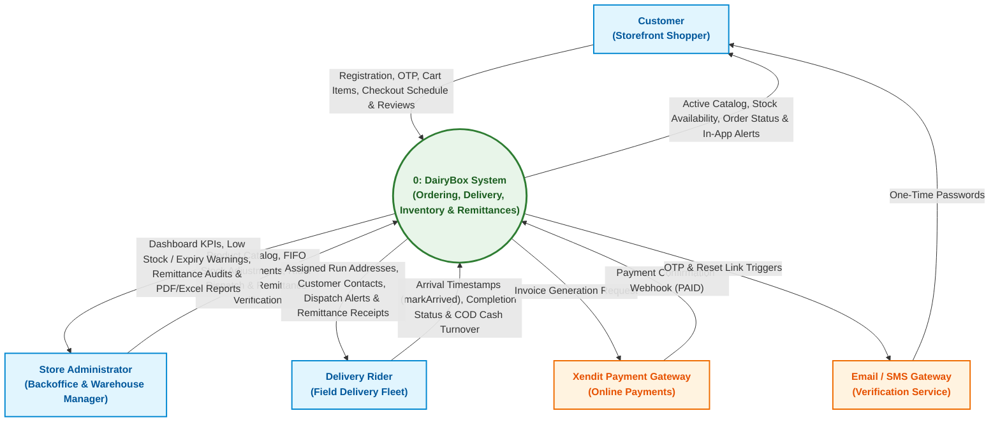

### Context Summary Matrix

| External Entity | Inputs Sent into DairyBox | Outputs Received from DairyBox |
| :--- | :--- | :--- |
| **Customer** | Account registration, credentials, OTP verification, cart selections (milk type, size, quantity), delivery address, order schedule time, cancellation reasons, and product ratings. | Dynamic catalog of dairy goods, stock and expiry badges, order confirmations, invoice redirection URLs, delivery tracking status, and account suspension warnings. |
| **Store Administrator** | Product lines, prices, image uploads, stock-in/stock-out batch adjustments (with manufacturing and expiry dates), order approvals, rider assignments, incident verifications, and remittance reconciliation inputs. | Real-time sales dashboards, low-stock warnings, near-expiry alerts (within 7 days), daily cash ledger balances, and downloadable PDF/Excel audit reports. |
| **Delivery Rider** | Real-time queue queries, arrival timestamp triggers (`markArrived`), delivery outcomes (`Delivered`, `Failed Delivery`, `Cancelled`), and collected Cash on Delivery (COD) funds. | Active delivery run assignments, route delivery addresses, customer phone numbers, in-app dispatch notifications, and verified remittance receipts. |
| **Xendit Payment Gateway** | Inbound asynchronous webhook callbacks containing invoice settlement status (`PAID`, `SETTLED`, `EXPIRED`) and payment channel. | Payment invoice generation requests containing order amount, customer details, and callback redirect URLs. |
| **Email / SMS Gateway** | Delivery confirmation of verification tokens. | Programmatic OTP requests for new user registration and password reset links. |

---

## 3. Level 1: System-Wide Data Flow Diagram

The **Level 1 DFD** decomposes the DairyBox system into **five interconnected functional zones**. It illustrates how data travels between the external actors, the application processes, and the database storage tables.

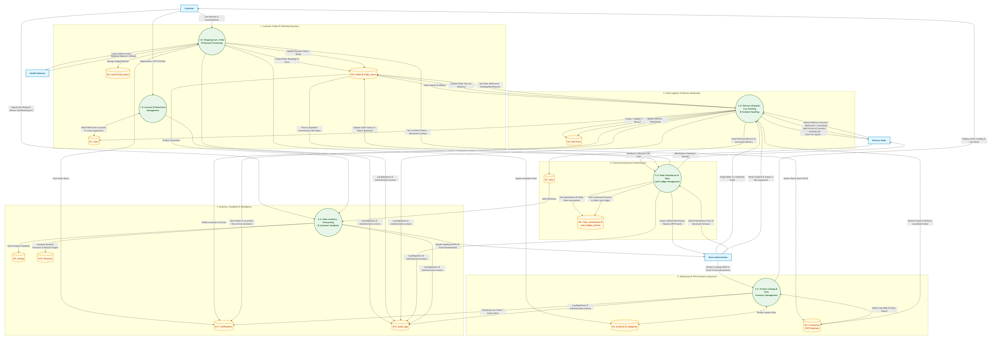
*High-Resolution Exports: [Ultra-HD PNG Image (7680x2679)](file:///c:/dairybox/docs/level_1_data_flow_diagram.png) | [Vector SVG](file:///c:/dairybox/docs/level_1_data_flow_diagram.svg)*

```mermaid
flowchart TD
    classDef entity fill:#E1F5FE,stroke:#0288D1,stroke-width:2px,color:#01579B,font-weight:bold;
    classDef process fill:#E8F5E9,stroke:#2E7D32,stroke-width:2px,color:#1B5E20,font-weight:bold;
    classDef store fill:#FFF8E1,stroke:#FFA000,stroke-width:2px,color:#E65100,font-weight:bold;

    %% External Entities
    Customer["Customer"]:::entity
    Admin["Store Administrator"]:::entity
    Rider["Delivery Rider"]:::entity
    Xendit["Xendit Gateway"]:::entity

    %% Subgraph 1: Customer Account & Ordering Subsystem
    subgraph Zone1 ["1. Customer Intake & Ordering Subsystem"]
        P1(("1.0: Account & Restriction\nManagement")):::process
        P3(("3.0: Shopping Cart, Order\n& Payment Processing")):::process
        D1[("D1: users")]:::store
        D4[("D4: carts & cart_items")]:::store
        D5[("D5: orders & order_items")]:::store
    end

    %% Subgraph 2: Warehouse Inventory Subsystem
    subgraph Zone2 ["2. Warehouse & FIFO Inventory Subsystem"]
        P2(("2.0: Product Catalog & FIFO\nInventory Management")):::process
        D2[("D2: products & categories")]:::store
        D3[("D3: inventories\n(FIFO Batches)")]:::store
    end

    %% Subgraph 3: Logistics & Fleet Fulfillment Subsystem
    subgraph Zone3 ["3. Fleet Logistics & Delivery Monitoring"]
        P4(("4.0: Delivery Dispatch, Live Tracking\n& Incident Handling")):::process
        D6[("D6: deliveries")]:::store
    end

    %% Subgraph 4: Financial Settlement & Daily Cash Ledger
    subgraph Zone4 ["4. Financial Settlement & Remittances"]
        P5(("5.0: Rider Remittance & Daily\nCash Ledger Management")):::process
        D7[("D7: sales")]:::store
        D8[("D8: rider_remittances &\ncash_ledger_entries")]:::store
    end

    %% Subgraph 5: Analytics & Intelligence Subsystem
    subgraph Zone5 ["5. Analytics, Feedback & Intelligence"]
        P6(("6.0: Sales Analytics, Forecasting\n& Customer Feedback")):::process
        D9[("D9: ratings")]:::store
        D10[("D10: forecasts")]:::store
        D11[("D11: notifications")]:::store
        D12[("D12: audit_logs")]:::store
    end

    %% Core Data Interconnections
    Customer -->|"Registration, OTP & Profile"| P1
    P1 <-->|"Read/Write User Accounts & 3-Day Suspensions"| D1
    Customer -->|"Cart Batches & Customizations"| P3
    P3 <-->|"Manage Staged Batches"| D4
    P3 -->|"Create Order (Pending) & Items"| D5
    P3 -->|"Deduct Batch Stock (FIFO)"| D3
    P3 -->|"Update Available Stock"| D2
    P3 -->|"Create Online Invoice"| Xendit
    Xendit -->|"Webhook Payment Callback"| P3
    P3 -->|"Update Payment Status (Paid)"| D5
    P3 -->|"Push Order Alerts"| D11

    Admin -->|"Product Catalog CRUD & Stock In/Out Adjustments"| P2
    P2 <-->|"Product Master Data"| D2
    P2 <-->|"Batch Logs (Mfg & Expiry Dates)"| D3
    P2 -->|"Broadcast Low Stock / Expiry Alerts"| D11
    P2 -->|"Display Active Catalog & Live Stock"| Customer

    Admin -->|"Assign Rider to Confirmed Order"| P4
    D5 -->|"Order Details & Address"| P4
    P4 -->|"Create / Update Delivery Record"| D6
    P4 -->|"Update Order (Out for Delivery)"| D5
    P4 -->|"Dispatch Alerts & Real-time Live Queue"| Rider
    Rider -->|"Mark Arrival at Location (arrived_at)"| P4
    P4 -->|"Notify Customer of Arrival"| D11
    Rider -->|"Submit Delivery Outcome (Delivered / Cancelled)"| P4
    P4 -->|"Update Delivery Timestamps"| D6
    P4 -->|"Set Order (Delivered - Pending Remittance)"| D5
    P4 -->|"Restock Goods if Delivery Cancelled/Failed"| D3
    P4 -->|"Alert Admin if Cancelled Post-Arrival (Incident)"| D11
    Admin -->|"Verify Incident & Impose 3-Day Suspension"| P4
    P4 -->|"Set Customer Status = Restricted (3 Days)"| D1

    P4 -->|"Insert Revenue Record on Successful Delivery"| D7
    Rider -->|"Handover Collected COD Cash"| P5
    D5 -->|"Fetch Completed Unremitted COD Orders"| P5
    Admin -->|"Submit Remittance Form & Reconcile Variance"| P5
    P5 -->|"Save Remittance & Order Pivot Associations"| D8
    P5 -->|"Update Order Status to 'Paid & Remitted'"| D5
    P5 -->|"Post Confirmed Turnover to Daily Cash Ledger"| D8
    P5 -->|"Remittance Clearance Receipt"| Rider
    P5 -->|"Export Audited Remittance Reports (PDF/Excel)"| Admin

    Customer -->|"Submit Star Rating & Review (Verified Buyers)"| P6
    P6 -->|"Store Product Feedback"| D9
    D7 -->|"Sales Revenues"| P6
    D5 -->|"Product Quantities"| P6
    P6 -->|"Compute Demand Forecasts & Restock Targets"| D10
    P6 -->|"Render Dashboard KPIs & Trend Visualizations"| Admin
    P1 & P2 & P3 & P4 & P5 & P6 -->|"Log Regulatory & Administrative Actions"| D12
```

---

## 4. Focused Subsystem Workflows (Easy-to-Read Deep Dives)

To eliminate confusion, the six major system operations are broken down into four clear, standalone diagrams with plain-English step-by-step explanations.

---

### 4.1 Subsystem 1: Customer Ordering & Payment Flow

This workflow illustrates how a customer selects products, customizes dairy options, and places an order with atomic stock deduction and optional online payment.

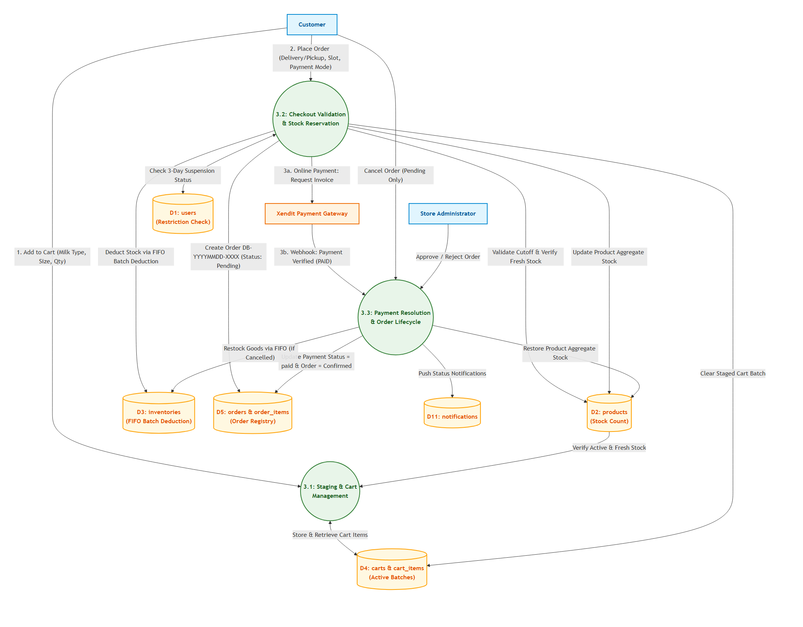
*Exports: [PNG Image (2114x1655)](file:///c:/dairybox/docs/dfd_subsystem_ordering.png) | [Vector SVG](file:///c:/dairybox/docs/dfd_subsystem_ordering.svg)*

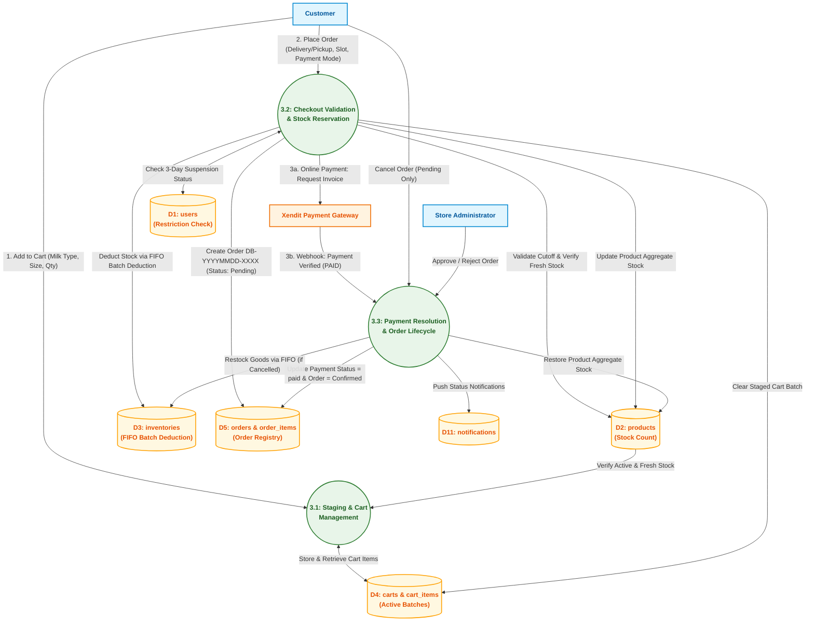

#### Step-by-Step Logic
1. **Cart Staging (`CartController::add`)**: The customer chooses milk type (Carabao or Cow), container size, and quantity. Items are staged in `carts` and `cart_items`. Expired or zero-stock products are rejected.
2. **Restriction & Cutoff Checks (`CartController::placeOrder`)**:
   * Checks `users.restricted_until`. If the customer was previously suspended, checkout is blocked.
   * Checks time cutoff: For same-day orders, morning delivery slots cut off at 12:00 PM, and afternoon slots cut off at 5:00 PM.
3. **Atomic Stock Reservation (`InventoryService::deductStock`)**: In a single database transaction, stock is deducted from the oldest active inventory batch in `inventories` (**FIFO** rule), aggregate stock in `products` is decreased, and a new record in `orders` is generated with order number format `DB-YYYYMMDD-XXXX`.
4. **Payment Processing**:
   * If **Cash on Delivery (COD)**: Order status becomes `Pending` awaiting store approval.
   * If **Xendit**: An online payment invoice is created via API. When the customer pays, Xendit hits `XenditWebhookController::handle` which automatically marks the order as `paid` and status as `Confirmed`.
5. **Stock Reversal on Cancellation**: If an order is cancelled while pending, `InventoryService::addStock` automatically restores units to inventory.

---

### 4.2 Subsystem 2: Fleet Delivery, Live Tracking & Incident Resolution

This workflow covers admin dispatch, rider live queue polling, customer location arrival alerts, and enforcement of the 3-day account suspension policy for post-arrival cancellations.

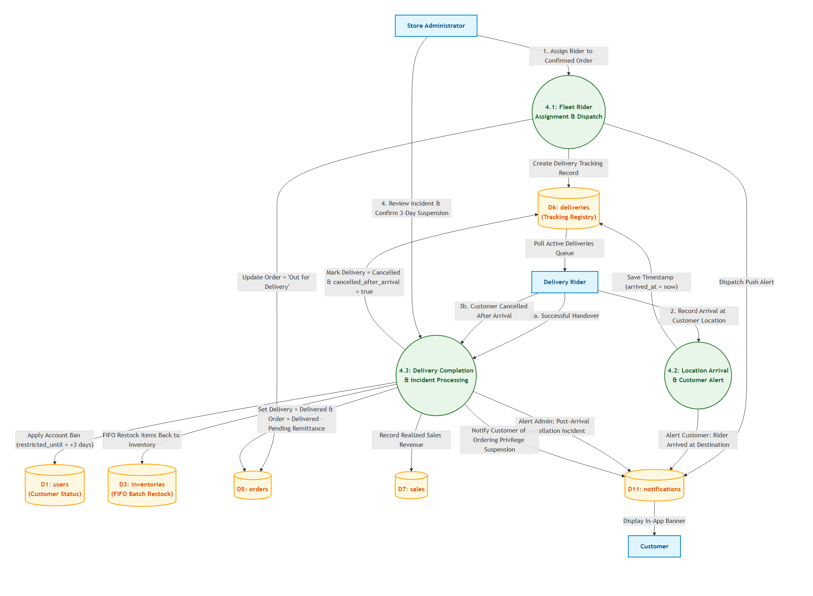
*Exports: [PNG Image (2049x1502)](file:///c:/dairybox/docs/dfd_subsystem_delivery.png) | [Vector SVG](file:///c:/dairybox/docs/dfd_subsystem_delivery.svg)*

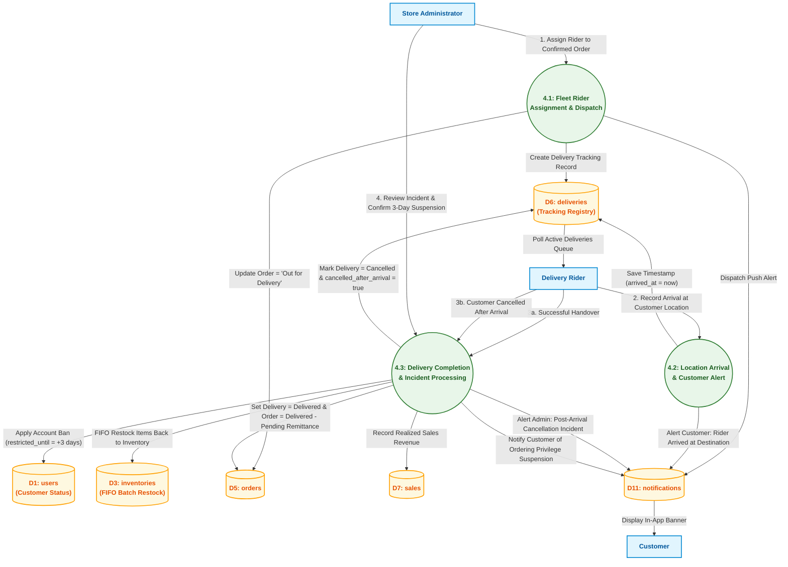

#### Step-by-Step Logic
1. **Assignment (`OrderController::assignRider`)**: The administrator assigns an active rider. The order is automatically progressed to `Out for Delivery`, a tracking record is saved in `deliveries`, and the rider receives a push notification.
2. **Live Queue & Polling (`RiderController::liveCheck`)**: The rider dashboard polls active runs and pending dispatch orders in real-time.
3. **Arrival Notification (`RiderController::markArrived`)**: When reaching the customer's doorstep, the rider taps "Arrived". The system records `arrived_at = now()` and dispatches an instant notification to the customer.
4. **Successful Delivery**: The rider marks "Delivered". The order changes to `Delivered - Pending Remittance` (for COD) and a sales transaction is registered in `sales`.
5. **Abuse Prevention / Post-Arrival Incident (`DeliveryController::verifyAndRestrict`)**:
   * If a customer refuses or cancels the order after the rider has arrived at the location, the delivery is flagged as `cancelled_after_arrival = true`.
   * The products are automatically restored to inventory.
   * Store management reviews the incident log in the Delivery Monitoring Center and confirms the suspension, which sets `users.status = 'restricted'` and `users.restricted_until = now() + 3 days`.

---

### 4.3 Subsystem 3: Rider Cash Remittance & Daily Cash Ledger

This workflow explains how Cash on Delivery (COD) funds collected by riders in the field are accounted for, checked for variances, and officially logged into the store's cash ledger.

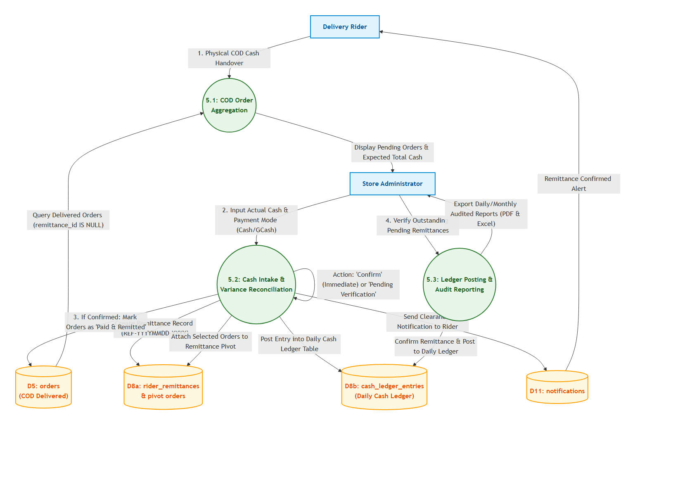
*Exports: [PNG Image (1676x1213)](file:///c:/dairybox/docs/dfd_subsystem_remittance.png) | [Vector SVG](file:///c:/dairybox/docs/dfd_subsystem_remittance.svg)*

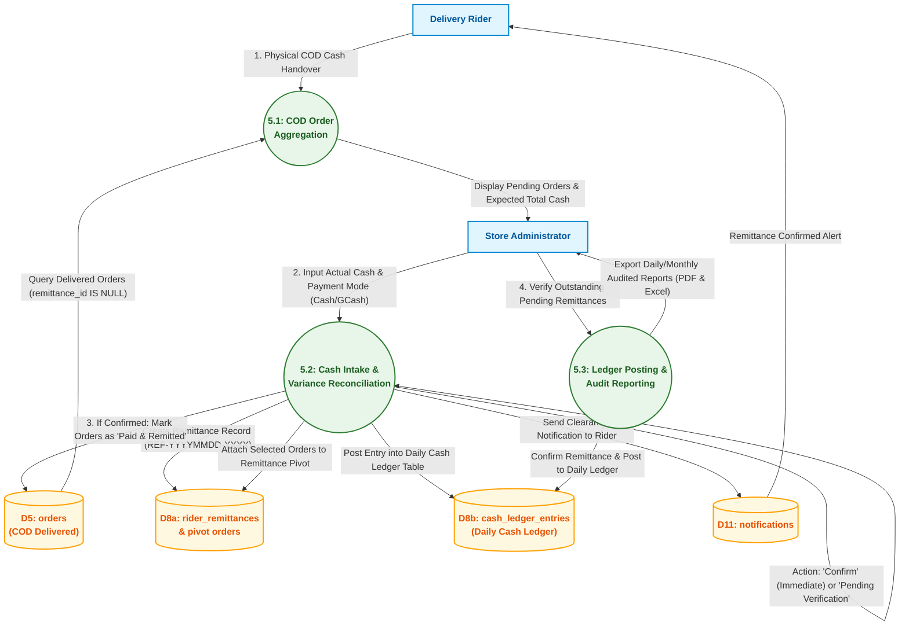

#### Step-by-Step Logic
1. **Unremitted Order Aggregation (`RiderRemittanceController::getRiderOrders`)**: The system queries all orders delivered by this rider where payment method is COD and `remittance_id` is null, summing the `expected_amount`.
2. **Remittance Input (`RiderRemittanceController::store`)**: The administrator inputs the actual cash tendered by the rider. The system calculates:
   $$\text{Variance} = \text{Actual Amount} - \text{Expected Amount}$$
   A negative variance signifies a cash shortage; a positive variance denotes an overage.
3. **Dual Confirmation Flow**:
   * **Immediate Confirm**: Orders are linked via `rider_remittance_orders` pivot, updated to `Paid & Remitted`, and an immutable line is inserted into `cash_ledger_entries`.
   * **Pending Verification**: Remittance is created in a hold status (`pending_verification`) for manager review. When later verified (`RiderRemittanceController::verify`), the ledger entry is posted and orders are marked paid.
4. **Reporting (`RiderRemittanceController::exportPdf / exportExcel`)**: Generates official audit summaries with date range filtering.

---

### 4.4 Subsystem 4: Warehouse FIFO Inventory & Expiration Management

This workflow illustrates how fresh dairy batches enter the warehouse, how stock is consumed in FIFO sequence, and how automated alerts protect customers from spoiled milk.

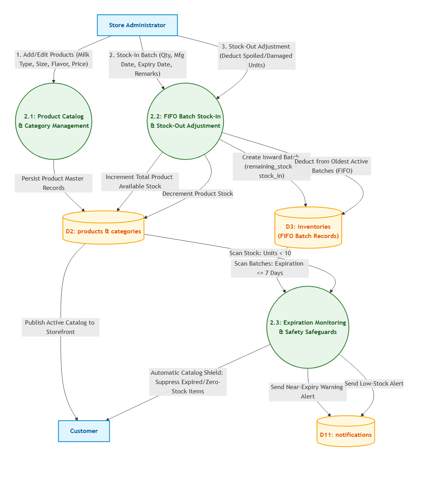
*Exports: [PNG Image (1137x1249)](file:///c:/dairybox/docs/dfd_subsystem_inventory.png) | [Vector SVG](file:///c:/dairybox/docs/dfd_subsystem_inventory.svg)*

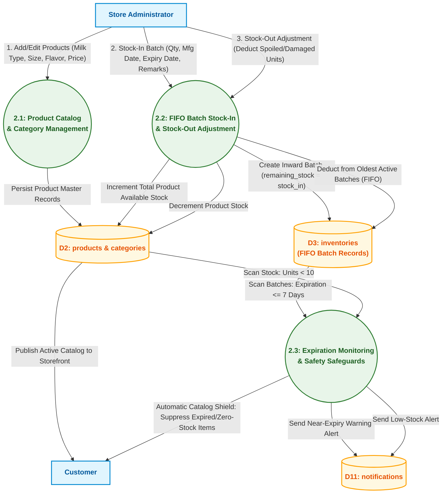

#### Step-by-Step Logic
1. **Catalog Definition (`ProductController`)**: Configures dairy specifications: Carabao vs. Cow milk, bottle volume (Small, Medium, Large), and flavor variations.
2. **Stock-In Batches (`InventoryController::adjust`)**: Records arrival of newly bottled batches with required manufacturing date and expiration date. Sets `remaining_stock = stock_in` in `inventories` and increments aggregate stock in `products`.
3. **FIFO Stock Deduction (`InventoryService::deductStock`)**: When customers buy milk or staff deduct damaged bottles, stock is consumed strictly from the oldest batch with remaining balance.
4. **Automated Freshness Guard (`ExpiryNotificationService`)**:
   * Evaluates batch expiration dates daily. Any product batch expiring within 7 days triggers administrative alerts.
   * If a batch reaches its expiration date, it is suppressed from customer storefront views so expired dairy products cannot be ordered.

---

## 5. Complete Database Data Store Directory

| Store ID | Table Name | Key Attributes | Description | Primary Writers | Primary Readers |
| :--- | :--- | :--- | :--- | :--- | :--- |
| **D1** | `users` | `id`, `name`, `email`, `role`, `status`, `restricted_until` | Stores credentials, user roles (`customer`, `rider`, `admin`), OTP tokens, and temporary 3-day restriction bans. | `AuthController`, `CustomerController` | All controllers (`check.restriction` middleware) |
| **D2** | `products`, `categories` | `id`, `category_id`, `product_name`, `milk_type`, `size`, `price`, `stock`, `status` | Master product catalog containing active statuses, pricing, bottle sizes, and aggregated stock totals. | `ProductController`, `InventoryService` | `StoreController`, `CartController`, `OrderController` |
| **D3** | `inventories` | `id`, `product_id`, `stock_in`, `stock_out`, `remaining_stock`, `manufacturing_date`, `expiration_date` | Detailed FIFO batch ledger tracking each warehouse intake and release with specific expiration dates. | `InventoryController`, `InventoryService` | `InventoryController`, `ExpiryNotificationService` |
| **D4** | `carts`, `cart_items` | `id`, `customer_id`, `cart_id`, `product_id`, `quantity`, `subtotal` | Shopping cart holding area that allows customers to manage multiple separate checkout batches. | `CartController` | `CartController` |
| **D5** | `orders`, `order_items` | `id`, `order_number`, `customer_id`, `rider_id`, `order_status`, `payment_method`, `total_amount` | Master order transactions storing scheduling, delivery destinations, and payment states. | `CartController`, `OrderController`, `XenditWebhookController` | Admin, Rider, and Customer Order Controllers |
| **D6** | `deliveries` | `id`, `order_id`, `rider_id`, `delivery_status`, `arrived_at`, `delivered_at`, `cancelled_after_arrival` | Real-time dispatch registry monitoring rider location arrival, delivery completion, and post-arrival incidents. | `OrderController`, `RiderController`, `DeliveryController` | `RiderController`, `DeliveryController` |
| **D7** | `sales` | `id`, `order_id`, `total_amount`, `sales_date` | Financial sales records generated upon confirmed delivery, powering revenue charts and accounting KPIs. | `RiderController`, `OrderController` | `DashboardController`, `ReportController` |
| **D8** | `rider_remittances`, `rider_remittance_orders`, `cash_ledger_entries` | `id`, `reference_no`, `rider_id`, `expected_amount`, `actual_amount`, `variance`, `status`, `ledger_date` | Financial reconciliation store capturing rider cash handovers, order pivot links, and daily cash ledger entries. | `RiderRemittanceController` | `RiderRemittanceController` |
| **D9** | `ratings` | `id`, `customer_id`, `product_id`, `rating`, `review` | Customer reviews and 1 to 5 star scores submitted by customers who have purchased the product. | `RatingController` | `StoreController`, `DashboardController` |
| **D10** | `forecasts` | `id`, `product_id`, `forecast_month`, `predicted_sales`, `confidence_score` | Calculated mathematical forecasts of future product demand and suggested restock quantities. | `ForecastController`, `ForecastService` | `ForecastController`, `DashboardController` |
| **D11** | `notifications` | `id`, `user_id`, `title`, `message`, `link`, `is_read` | Unified notification center distributing push messages and alerts across customers, riders, and admins. | All Controllers | `NotificationClickController`, All Dashboards |
| **D12** | `audit_logs` | `id`, `user_id`, `action`, `details`, `ip_address` | Immutable regulatory audit log capturing administrative actions, stock changes, cancellations, and remittances. | All Controllers | Store Administrators |

---

## 6. Real-World End-to-End Walkthrough

To see how all these pieces fit together, consider a standard order scenario:

```
[Customer] Adds 2 Carabao Milk Bottles to Cart
    │
    ▼
[Process 3.0: Order Checkout]
    ├── Checks D1: Customer is not suspended (restricted_until is null)
    ├── Checks D3: Validates batch expiration > today
    ├── Writes D3: Deducts 2 units from oldest FIFO inventory batch
    ├── Writes D2: Decrements aggregate product stock
    └── Writes D5: Generates Order #DB-20261112-0001 (Status: Pending)
    │
    ▼
[Process 4.0: Fleet Dispatch]
    ├── Admin assigns Rider A to Order #DB-20261112-0001
    ├── Writes D6: Creates delivery record (Status: Out for Delivery)
    ├── Writes D11: Pushes dispatch alert to Rider A
    └── Rider A taps "Arrived" -> Writes D6: arrived_at = now() -> Customer notified
    │
    ▼
[Customer Receives Milk & Hands Over ₱300 COD Cash]
    ├── Rider marks "Delivered" -> Writes D6 (Status: Delivered), D5 (Status: Delivered - Pending Remittance)
    └── Writes D7: Realized sale of ₱300 logged into sales table
    │
    ▼
[Process 5.0: End-of-Day Settlement]
    ├── Rider A brings ₱300 COD cash to Admin
    ├── Admin selects Order #DB-20261112-0001 (Expected: ₱300, Actual: ₱300, Variance: ₱0.00)
    ├── Admin clicks "Confirm Remittance"
    ├── Writes D8: Remittance REF-20261112-0001 created
    ├── Writes D8: Transaction posted to Daily Cash Ledger table
    ├── Writes D5: Order updated to "Paid & Remitted"
    └── Writes D11: Clearance receipt sent to Rider A
```

This completes the clear and detailed Data Flow Diagram specification for the DairyBox platform.
